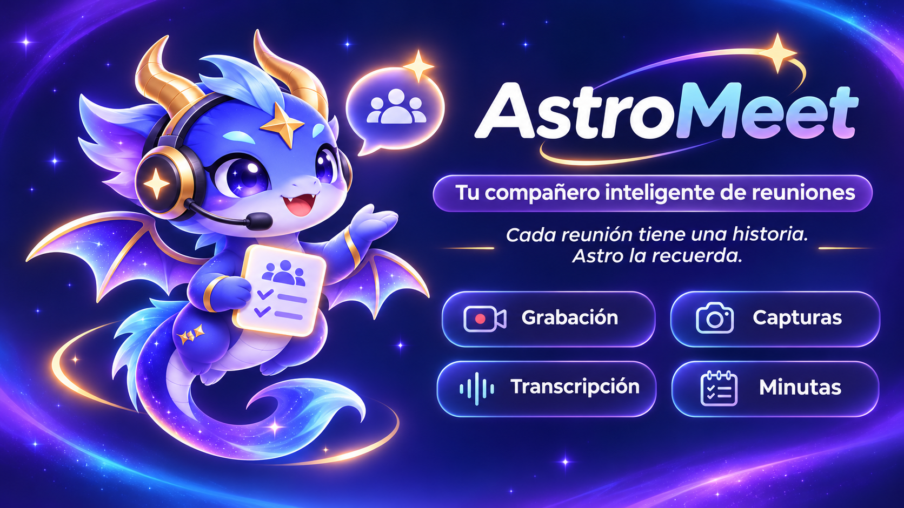

# AstroMeet

**Tu compañero inteligente de reuniones**

> Cada reunión tiene una historia. Astro la recuerda.

**Grabación · Capturas · Transcripción · Minutas**

## Identity

| | |
| --- | --- |
| **Application** | AstroMeet |
| **Mascot** | Astro |
| **Slogan** | Cada reunión tiene una historia. Astro la recuerda. |

## What it is

AstroMeet is a Windows desktop app that records your meetings (Microsoft Teams or any other call) and turns them into something you can use afterwards. Its first priority is **never losing the audio**.

- **Grabación (recording):** captures your microphone and the Windows system output as separate, recoverable audio segments, so an interrupted session can still be recovered.
- **Capturas (screenshots):** mark an important moment during the meeting; AstroMeet saves its time in the recording and a screenshot of the Teams window.
- **Transcripción (transcription):** transcribes the finished recording locally on the CPU, with timestamps, without sending audio to the cloud. It can also use the visible Teams participant labels to tell who was speaking.
- **Minutas (minutes):** drafts the meeting minutes (objective, attendees, topics, decisions, tasks, and open items) from the transcript and the marked moments, using a locally installed Claude Code or Codex CLI.

Astro, the mascot, floats on screen and shows what the app is doing: recording, capturing, processing, or done.

Recording and transcription run on your machine, with no GPU, no Node or Electron, and no private Microsoft Teams APIs. Only the minutes step sends the transcript text, never the audio or screenshots, to the AI CLI you choose.

## Get started

- **Download:** the installer for each version is on the [Releases](https://github.com/BastianMoyano/Trans-lite-team/releases) page.
- **Develop:** the source, requirements, installation, and tests are documented in [`teams-lite-mvp/README.md`](teams-lite-mvp/README.md).
