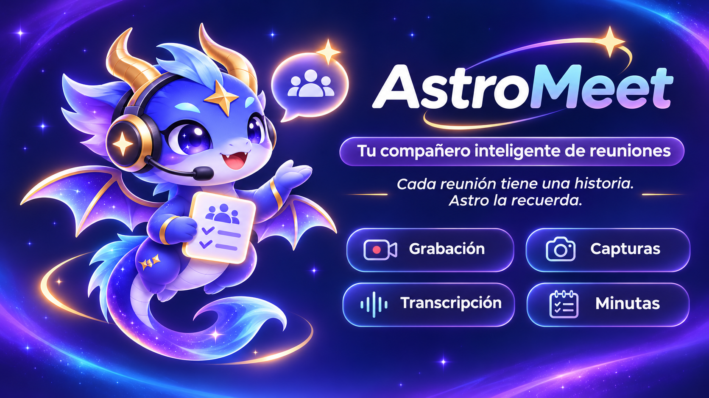

# AstroMeet



**Tu compañero inteligente de reuniones**

> Cada reunión tiene una historia. Astro la recuerda.

**Grabación · Capturas · Transcripción · Minutas**

AstroMeet is a Windows desktop MVP that prioritizes **not losing meeting audio**. It records the default microphone and Windows system output as separate, recoverable WAV segments, stores metadata in SQLite, and optionally transcribes finalized audio with NVIDIA Parakeet TDT 0.6B V3 through ONNX Runtime on CPU.

It does not use Node, Electron, a GPU, or private Microsoft Teams APIs.

## What works in this deliverable

- PySide6 desktop UI with visible recording state.
- Separate microphone and default Windows output-loopback capture.
- Native multichannel WASAPI capture with an explicit mono downmix, avoiding SoundCard's documented defective mono-recording path.
- 30-second WAV segments by default, with raw `.pcm.part` recovery after interruption.
- SQLite meetings, streams, segments, timestamps, statuses, and error events.
- Automatic post-recording transcription pipeline with CPU-only ONNX provider selection.
- Transcription progress on the meeting's card in "Grabaciones recientes" ("Transcribiendo 45 %" plus a progress bar), measured by the share of audio already processed.
- Update notice: on startup the app asks GitHub for the latest release and, when it is newer, offers to download its installer.
- Timestamped JSON and plain-text transcript export.
- Conservative labels: microphone is `Local`; loopback is `Remote/Unknown`.
- Optional screenshot plus Tesseract OCR name hints.
- Optional Microsoft Teams window sampling across multiple monitors.
- Optional WeVisOne-VL active-tile localization and timestamped visible-name attribution.
- Unit tests that do not require Teams, audio hardware, Tesseract, or model downloads.

## What still requires validation on real Teams PCs

- Concurrent microphone and WASAPI loopback stability on each audio-driver combination.
- Long meetings, sleep/resume, device changes, Bluetooth headsets, and Teams device switching.
- Actual Parakeet model download/layout, memory use, speed, and accuracy on target CPUs.
- Timestamp drift between independent microphone and loopback devices.
- Active-speaker border and name recognition across Teams layouts, display scales, languages, and themes.
- WeVisOne-VL 2B latency and memory use on the target machine's CPU-only runtime.
- Code signing: the installer and executable are unsigned, so Windows SmartScreen warns on first run.

The application does not identify a person from their voice. When enabled, it uses Teams' visible active-speaker border and participant label as time-bounded evidence. Missing, weak, or conflicting visual evidence remains `Remoto/Desconocido`.

## Requirements

- 64-bit Windows 10 or 11.
- 64-bit CPython 3.12 (recommended).
- 32 GB RAM recommended for the full transcription option.
- Microsoft Visual C++ 2019 or later runtime for ONNX Runtime.
- Tesseract OCR only if the optional OCR feature is enabled.
- Approximately 5 GB of model storage plus substantial RAM if WeVisOne-VL 2B is enabled.

Compatibility was checked on 2026-11-12 against PySide6 6.11–6.12, SoundCard 0.4.6, onnx-asr 0.12.0, and ONNX Runtime 1.31.1. `onnx-asr` is a third-party Beta package, so keep these versions pinned until real-device validation is complete.

## Install

If the project is stored under a very long Windows path, create the virtual environment through a temporary drive mapping; Qt contains deeply nested files and Windows may otherwise reject installation:

```powershell
subst T: $PWD.Path
py -3.12 -m venv T:\.venv
T:\.venv\Scripts\Activate.ps1
```

For a normal-length path:

```powershell
py -3.12 -m venv .venv
.\.venv\Scripts\Activate.ps1
python -m pip install --upgrade pip
pip install -e ".[asr,ocr,dev]"
Copy-Item config.example.json config.json
```

For capture-only operation, omit optional extras:

```powershell
pip install -e ".[dev]"
```

### Prepare Parakeet ONNX files

The UI deliberately avoids downloading a model while recording. Pre-provision the model once, then point `parakeet_model_dir` in `config.json` at that directory:

```powershell
python -c "import onnx_asr; onnx_asr.load_model('nemo-parakeet-tdt-0.6b-v3', 'models/parakeet-v3')"
```

This downloads community ONNX conversion files used by `onnx-asr`; it is not NVIDIA's original `.nemo` runtime. Pin and validate the downloaded revision before production use.

### Optional Tesseract

Install Tesseract separately. With `tesseract_cmd` set to `null`, the app looks for it on `PATH` and then in `Tesseract-OCR\tesseract.exe` under `%ProgramFiles%`, `%ProgramFiles(x86)%` and `%LOCALAPPDATA%\Programs`, where its Windows installer puts it without touching `PATH`. Set `tesseract_cmd` only for another location. Set `ocr_enabled` to `true` to build an attendee list for the meeting minutes:

- Only the visible Teams window (`teams_window_title`) is read, never the whole screen. If Teams is not visible, nothing is captured.
- The window is read when recording starts and every 60 seconds; "Capturar asistentes ahora" reads it on demand.
- Screenshots are deleted right after OCR; only the detected names are kept, in `data/<meeting>/participants.json`.
- Only text that looks like a display name (2–5 capitalized words, no digits or symbols) is kept; Teams UI labels are ignored.
- Copiar and Descargar prepend `Asistentes (detectados por OCR): ...` to the transcript.
- With only the `eng` Tesseract language, accents may be dropped (`Díaz` → `Diaz`). Installing `spa.traineddata` enables `spa+eng` automatically.

`ocr_region` is no longer used.

### Optional active-speaker identification

Install the visual runtime separately because PyTorch and WeVisOne-VL are large:

```powershell
pip install -e ".[vision]"
hf download tencent/WeVisOne-VL-2B --local-dir models/wevisone-vl-2b
```

Set `visual_speaker_enabled` to `true`. `visual_sample_seconds` controls sampling frequency, `teams_window_title` selects the visible Teams window, and `wevisone_model_dir` points to the local model. The model runs outside the audio threads; visual failure never stops audio recording.

Before each recording the app checks that the model folder contains `config.json` and its weights (`model.safetensors`). If the download is incomplete, the recording continues with audio only and the status line explains what is missing. If the model fails to load during a recording, frame sampling stops and the same warning is shown. `wevisone-vl` is pinned to a tested commit in `pyproject.toml`.

### Important moments

While recording, "Marcar momento" (with an optional note) or the global hotkey **Ctrl+Alt+M** marks the current instant, even while Teams has focus; the hotkey plays a short confirmation sound and is registered only during a recording.

- Each moment stores its time in the recording and a JPEG screenshot of the Teams window in `data/<meeting>/moments/` (index in `moments.jsonl`).
- If Teams is minimized or hidden, the moment is still recorded without a screenshot, and the status line says why. Windows does not render minimized windows, so nothing can be captured from them.
- Moments appear in the transcript at their time (double-click opens the screenshot) and are sent to the minutes as text only; screenshots never leave the machine.
- If another application already owns Ctrl+Alt+M, the recording card says so, the button and the mascot's *Capturar reunión* keep working, and AstroMeet retries the hotkey every 5 seconds until it is free.
- Each recording logs in its events whether the hotkey was ready (`moment_hotkey_ready`), taken by another application (`moment_hotkey_unavailable`) and every press it received (`moment_hotkey_pressed`), so a press that never marked a moment can be explained.
- Teams is captured with `PrintWindow(PW_RENDERFULLCONTENT)`: a plain screen grab of a WebView2/Chromium window returns black, while this works even when other windows cover Teams. All-black captures are discarded.
- With a single monitor while presenting, Teams is often minimized: a moment marked by hand then captures the monitor under the cursor (what participants are seeing). Automatic attendee OCR never captures the whole screen.

### Performance notes

- Transcription skips silence (`skip_silence=True`): only stretches with sound reach Parakeet. Each track is mostly silence while the other side talks; on short test meetings this saved 20–30 % of transcription time. Bursts shorter than 0.75 s are ignored because they made the model invent filler words.
- Parakeet loads per transcription (~23 s, ~2.2 GB RAM) and is released afterwards, so the idle app stays around 110 MB.
- Never declare a font fallback list in the stylesheet (`font-family: "Cascadia Mono", "Consolas"`): it made Qt load its whole font database, +230 MB of RAM and most of the startup time. `mono_font_family()` picks one installed family instead.
- The recordings list is painted by a delegate instead of one widget per meeting. With 300 meetings, startup went from 7.0 s to 0.6 s together with the font fix below.
- Transcript row heights are computed with font metrics and refreshed once after resizing (2-hour transcript: open 1.8 s → 0.2 s, resize 0.9 s → 0.02 s per step).
- The executable leaves out the optional WeVisOne stack (torch, transformers, scipy, matplotlib, av); see `TeamsLite.spec`.

### Audio devices during a meeting

- Microphone and system audio are recorded independently. If one device disappears (Bluetooth drops, USB unplugged), that stream retries on the current default device while the other keeps recording.
- If the Windows default device changes (for example, headphones plugged in), the stream switches to the new device; otherwise the old loopback would record silence with no error.
- These recovered problems are shown on the status line while recording and stored as meeting events. A stream that never captured anything still marks the meeting as failed.
- Each capture thread initializes COM itself. Before this, only the first recording of an app session captured audio; later ones failed with `CO_E_NOTINITIALIZED` (0x800401F0).

### Meeting minutes (Claude Code or Codex)

"Generar minuta" sends the transcript (plus the OCR attendee list) to a locally installed, signed-in AI CLI and saves the answer as `data/<meeting>/minutes.md`. The Minuta view renders it, and Copiar/Descargar act on the visible view. Choose the CLI in the selector next to the button; `minutes_cli` in `config.json` (`claude` or `codex`) sets the default.

- The meeting content leaves the machine and is processed by Anthropic (Claude) or OpenAI (Codex). Confirm this is allowed for the meeting.
- The transcript travels only through stdin, never as a command-line argument (the npm `.CMD` shims run through `cmd.exe`).
- Claude runs as `claude -p --tools "" --setting-sources "" --strict-mcp-config --no-session-persistence`: no tools, and none of the user's hooks, plugins or MCP servers. Loading user settings took ~100 s per run and hung when the model requested a tool; without them a run takes ~10–15 s.
- Codex runs as `codex exec --sandbox read-only --skip-git-repo-check --ephemeral -o <file> -`. Read-only still allows reading files, so Claude is the default.
- Both run in an empty temporary folder. A run that exceeds 10 minutes is cancelled and its whole process tree is killed; previous minutes are kept on any failure.

### Chat about the minutes

Ask Claude Code or Codex about what was said or decided, inside the app window; no terminal opens:

- **One meeting**: the **Chat con IA** view in Grabar, next to *Transcripción* and *Minuta*, talks about the selected meeting, with the CLI chosen in the selector next to *Generar minuta*.
- **A project**: in Biblioteca, open a project (or the Cofre de reuniones / Sin proyecto) and press **Conversar con IA**; the chat opens to the right of its meetings, with its own Claude/Codex selector.

Type a question and press Enter or *Enviar*; the answer appears in the panel while the app stays usable. Follow-up questions keep the context of the conversation. Each meeting and project keeps its own conversation, saved in `data/.chat/<scope>/conversation.json` after every answer: closing AstroMeet keeps it, and reopening continues the same CLI session with its context, with the CLI it started with. **Nueva conversación** starts over and forgets the saved one. A damaged file is ignored, and a saved session id that is not a plain id is never passed to the CLI (a new session starts instead). *Copiar* and *Descargar* in the Chat tab copy or save the conversation. Meetings with minutes, a transcript or both are included; one with only a transcript can be asked about before its minutes exist.

Before every question, the app rebuilds `data/.chat/<scope>/` with fresh copies of each meeting's `minutes.md` and `transcript.txt` (so minutes generated mid-conversation reach the next answer), an `INDEX.md` (title, date, folder) and the instructions in `CLAUDE.md` and `AGENTS.md`. Each question runs the CLI once in that folder, in the background and without a console window:

- Claude runs as `claude -p` with the read-only tools `Read,Grep,Glob`, without your Claude settings, hooks or MCP servers, and resumes the same session (`--session-id`, then `--resume`).
- Codex runs as `codex exec --sandbox read-only` and `codex exec resume <thread>` with `sandbox_mode=read-only`. It keeps your Codex configuration, including its plugins and MCP servers.

**Eliminar reunión** also removes the meeting's copies from every `data/.chat/` folder and its own conversation. Answers already given in a project conversation are not rewritten.

The agent cannot change any file. It starts in the copies, but read tools can still open other paths by absolute name, subject to each CLI's own permission prompts; it is not a filesystem sandbox. As with minutes, meeting content is sent to Anthropic or OpenAI, and questions and meeting text are never passed on the command line. Claude usually answers in seconds, Codex can take up to a minute; a question that takes more than 10 minutes is cancelled.

## Run

```powershell
teams-lite --config config.json
# or
python -m teams_lite --config config.json
```

### Build the Windows executable

Install the build extra after the runtime dependencies, then run the deterministic build script:

```powershell
pip install -e ".[asr,ocr,vision,build]"
.\build_windows.ps1
```

The executable is created at `%LOCALAPPDATA%\TeamsLite-build\dist\TeamsLite\TeamsLite.exe`, outside the project: when the project sits in OneDrive, its sync locks folders, PyInstaller cannot wipe the previous build (WinError 5), and every build would be uploaded. The build writes absolute local paths for `data_dir` and the model folders into the generated `config.json` next to the executable; model weights are not duplicated inside the executable folder. Recordings stay in the project `data` folder because PyInstaller wipes the output folder on every rebuild; the build refuses a `data_dir` inside it. Without `--config`, the executable reads the `config.json` next to `TeamsLite.exe`, regardless of the shortcut's start folder.

### Build the installer

Install [Inno Setup 6](https://jrsoftware.org/isinfo.php) (`winget install -e --id JRSoftware.InnoSetup`), then:

```powershell
.\build_windows.ps1 -Installer
```

This builds the executable and then `dist/installer/TeamsLite-Setup-<version>.exe` from `installer/TeamsLite.iss`. The version comes from `pyproject.toml`. The setup:

- Installs per user, without admin rights, to `%LOCALAPPDATA%\Programs\TeamsLite`, with a Start menu entry and a desktop shortcut (checked by default).
- Downloads the Parakeet model (~2.4 GB, pinned Hugging Face revision, SHA-256 verified) to `%LOCALAPPDATA%\TeamsLite\models\parakeet-v3`. Files already present with the right hash are not downloaded again. Installation needs internet access for this step.
- Writes `config.json` next to `TeamsLite.exe` with absolute paths: meetings in `%LOCALAPPDATA%\TeamsLite\data` and the model folder above. `tesseract_cmd` stays `null`, so the app finds Tesseract even when it is installed later. An existing `config.json` is kept on upgrade.
- Installs Tesseract OCR 5.4 by default (official UB-Mannheim build, downloaded from GitHub and SHA-256 verified; Windows asks for admin rights). The option is hidden when Tesseract is already installed; if the download or the permission fails, installation continues without it.
- Shows an "Instalando componentes" page with each component's status (Pendiente, Comprobando, Descargando with percentage, size and remaining time, Verificando, Instalando, Listo, Ya instalado, Omitido) and a total progress bar. A `/SILENT` or `/VERYSILENT` install hides this page. On a PC without Tesseract it still runs the Tesseract setup, which waits for the Windows admin prompt; for unattended deployments add `/MERGETASKS="!tesseract"` to skip it.
- Shows "Comprobando el modelo..." while it checks an existing model, which takes a few seconds; if the download fails it stays on the last page so you can retry, and a `/VERYSILENT` install records the reason in its `/LOG` file.
- Never ships the build machine's `config.json` (it holds that PC's absolute paths).

Uninstalling removes the program and the Parakeet model it downloaded (other folders in `%LOCALAPPDATA%\TeamsLite\models` stay); recorded meetings in `%LOCALAPPDATA%\TeamsLite\data` are kept. Meeting minutes still need the `claude` or `codex` CLI installed and signed in by each user; the installer does not bundle them.

### Updates

When AstroMeet opens, it asks `https://api.github.com/repos/BastianMoyano/Trans-lite-team/releases/latest` for the latest release, in the background and with a 5-second timeout. The request carries no meeting data, only a generic `TeamsLite-update-check` user agent. If the tag (for example `v0.2.0`) is newer than the running version, a banner offers **Descargar actualización**, which opens the release's `TeamsLite-Setup-<version>.exe` in the browser, and **Ahora no**. Offline, rate-limited or unexpected answers show nothing. Close AstroMeet before running the new installer; it upgrades in place and keeps meetings, `config.json` and the model.

To publish an update, raise `version` in `pyproject.toml` and `__version__` in `src/teams_lite/__init__.py` (a test keeps them equal), run `.uild_windows.ps1 -Installer`, and attach `dist/installer/TeamsLite-Setup-<version>.exe` to a GitHub release tagged `v<version>`.

### Using the app

1. Confirm the Windows default input/output devices match the devices Teams uses.
2. Notify participants and obtain any required consent.
3. Start recording before the important conversation begins.
4. Optionally enable active-speaker identification before recording; keep the Teams meeting window visible.
5. Stop recording. WAV finalization completes before CPU transcription starts.

### Organizations, projects and preview

The left menu has four sections, each drawn as one of Astro's rooms: a header with the section's pixel-art scene and gold subtitle (*La sala de comando de Astro*, *La biblioteca de Astro*, *La sala de planificación*, *La habitación de Astro*) over a dark indigo theme. The pixel art lives in `src/teams_lite/assets/room/`, cropped from the redesign mockups; a missing image is simply not drawn. The fourth section, **Mascota**, is described under *Mascot (Astro)*:

- **Grabar** has two halves. On the left, **Nueva grabación** (title, **Organización** and **Proyecto**) and, below it, **Grabaciones recientes**, which lists only the meetings of the organization and project chosen for recording; its header names them. With no organization chosen, meetings go to the **Cofre de reuniones**, the default place for unfiled meetings. Under the list, **Renombrar**, **Mover**, **Exportar**, **Liberar espacio** and **Eliminar reunión** act on the selected meeting. Renaming changes only the title; the folder on disk keeps its name. **Liberar espacio** deletes only the meeting's audio (`.wav` segments) after confirming how much it frees; the transcript, minutes, moments and screenshots stay. It refuses a meeting that is recording or has no transcript yet, and afterwards the meeting can no longer be transcribed again or exported with audio. A file Windows keeps in use is left in place and reported, so it can be freed later. Segments are marked before any file is deleted, so a release interrupted halfway never leaves a meeting claiming audio it no longer has, and the next **Liberar espacio** finishes it. On the right, the selected meeting over the full height, with the views *Transcripción*, *Minuta*, *Chat con IA* and **Capturas**. Windows narrower than 1120 px stack the halves. **Ver todas →** opens the Biblioteca.
- **Capturas** shows every screenshot of the meeting: marked moments in time order (with their note), then the active-speaker frames. Thumbnails load a few at a time, so long meetings stay responsive; double-click one to open it full size. **Copiar todas** puts every capture on the clipboard as files, ready to paste into Teams, Outlook or a folder; **Exportar todas…** saves them in a `.zip`, numbered in gallery order.
- **Biblioteca** browses organizations, then their projects (plus *Sin proyecto*), then their meetings newest first. Each meeting shows a thumbnail: the first marked moment's screenshot, otherwise the first active-speaker frame, otherwise a placeholder. At the top level the Cofre is a chest and each organization a folder; project cards use the newest meeting with a screenshot. Double-click a meeting to open it in Grabar, which also switches *Grabaciones recientes* to its project; right-click to rename, move or export it.
- **Organización** creates, renames and deletes organizations and projects. A stats bar shows how many organizations, projects and filed meetings there are and how many meetings wait in the Cofre. Each row shows its meeting count, the project column is titled with the selected organization, and empty lists say what to do next. Names are unique, ignoring case (projects within their organization). Deleting an organization sends its meetings to the Cofre; deleting a project keeps its meetings in the organization without a project. Meetings are never deleted from here.

Filing is metadata only: a moved meeting keeps its folder under `data/`. Databases from earlier versions gain the new columns on first launch, and their meetings appear in the Cofre.

### Mascot (Astro)

**Astro**, a small pixel-art astral dragon, floats over the other windows, Teams included, so recording does not need AstroMeet in front. It only shows what really happens:

- **Listo para comenzar** while idle, **Grabando reunión** during a recording (with a timer), **Deteniendo** until the audio is stored, **Procesando grabación** with the transcription percentage, **¡Reunión guardada!** when the audio or the transcript is saved, **Captura realizada** (or the OCR result) after a capture, and a worried face with the error text when something fails. Short messages appear in a pixel-art bubble.
- **Click Astro** to unfold its actions around it, without moving it: **Grabar** on the left starts recording at once, without asking for a title, organization or project, and becomes **Detener** while recording; **Capturar** on the right marks a moment with a screenshot, like Ctrl+Alt+M; **OCR** below reads the attendees. Capturar and OCR work while recording. The buttons fold back after an action or a few seconds.
- **Double-click Astro** to open AstroMeet. **Drag it** anywhere; it flies while moved and remembers where it was left. It never takes the keyboard from Teams. Closing AstroMeet closes it.
- Astro only mirrors events: if drawing it ever fails, recording carries on untouched. Its timers stop while it is hidden or still.

Astro's settings live in the **Mascota** section only. It sets what Astro records with (the meeting title, default *Reunión rápida*; the organization and project, none means the Cofre de reuniones) and how it looks: shown or hidden, sound on or off, animations on or off (off shows a still frame), size (×2 to ×5, always pixel-sharp), the character (its *¿Cómo funciona?* card previews the chosen character's pixel art, so Astro or Brasa can be seen before it floats over Teams), and a button to put it back in its starting corner. Changes apply at once and are stored in `data/mascot.json`. If the default organization is deleted, the default becomes the Cofre; if only the default project is gone, a quick recording stays in the organization without a project and the status says so.

AstroMeet ships two characters, **Astro** (an astral dragon) and **Brasa** (an ember salamander-dragon), each with eight animated states; a code-drawn placeholder covers any missing state. Your own spritesheets in `data/mascots/<character>/` replace a shipped character or add a new one: see [docs/astro-sprites.md](docs/astro-sprites.md) for the folder layout (`data/mascots/<character>/`), the eight states, the PNG rules and ready-to-use prompts.

### Sharing meetings (export and import)

**Exportar** under *Grabaciones recientes* (or right-click › **Exportar…** in Biblioteca) saves the meeting as a `.zip` package. It holds the transcript, minutes, marked moments with their screenshots, attendees and the first active-speaker frame. **Incluir audio** is off by default; turn it on when the receiver should be able to transcribe again (a one-hour meeting adds several hundred MB).

**Importar…** in Biblioteca adds a package as a new meeting. The destination starts on the organization or project being browsed. At the top level it starts on the organization and project with the same names as the sender's, ignoring case, or on the Cofre when there is no match. The meeting keeps its original title, date and status, and importing the same package twice creates two meetings. Packages are checked before anything is written: a damaged package, one from a newer AstroMeet, or one with paths that leave the meeting folder is rejected and changes nothing.

Meeting data is stored under `data/<meeting-id>/`; metadata is in `data/meetings.sqlite3`. New meetings use a readable, unique folder name: local start date, hour and minute, then the title (for example `data/2026-11-13 07-44 Daily ventas/`). Characters Windows does not allow in names become `_`, the title is cut to 40 characters, and a second meeting with the same minute and title gets ` (2)`. Meetings recorded before this change keep their original folder.

## Recovery model

Each capture stream writes raw 16-bit PCM to a `.pcm.part` file. On segment rotation or stop, a separate finalizer writes a WAV header, flushes the file, atomically replaces the final path, and then marks the SQLite row finalized. On the next launch, rows left in `writing` state are recovered when possible and meetings left in `recording` state become `interrupted`.

This minimizes loss, but it is not a hard real-time or forensic recorder. Abrupt power loss may still lose the operating system's unwritten disk cache.

## Tests

```powershell
python -m pytest
# stdlib-only runner if pytest is not installed
$env:PYTHONPATH = "src"
python -m unittest discover -s tests -v
```

The tests cover SQLite persistence/recovery, segmented audio with fake devices, configuration, OCR text filtering, transcription chunking/exports with a fake recognizer, and conservative speaker labels.

## Project structure

```text
src/teams_lite/
  app.py            PySide6 UI and background orchestration
  audio.py          microphone/loopback capture and segment rotation
  storage.py        SQLite schema, organizations/projects and interrupted-segment recovery
  library_ui.py     organization/project picker, Biblioteca and Organización pages
  room.py           Astro's rooms: section headers, room backdrop, side-rail lantern, illustrated empty states
  chat.py           chat workspace and multi-turn Claude/Codex sessions
  chat_ui.py        chat panel shown in Grabar and Biblioteca
  mascot.py         mascot defaults (data/mascot.json) and where a quick recording is filed
  mascot_ui.py      Astro on screen (sprite, bubble, menu) and the Mascota section with its preview
  astro.py          Astro's state machine, driven by real recording events
  astro_sprites.py  character spritesheets and the pixel-art placeholder
  previews.py       picks the screenshot that represents a meeting
  sharing.py        meeting export/import packages (.zip)
  transcription.py  CPU ONNX transcription and timestamped exports
  speakers.py       conservative source labels/manual mapping
  ocr.py            optional screenshot OCR hints
  window_capture.py multi-monitor Teams window sampling
  wevisone.py        optional active-tile and visible-name detector
  visual_speakers.py timestamped evidence persistence and transcript matching
  config.py         validated JSON settings
tests/               hardware-independent unit tests
odd/tasks/           implementation logbook and acceptance specs
```

## Important limitations

- System loopback captures the selected Windows render endpoint, not Teams by process name.
- Native device channels are averaged to one mono archival track; this is intentionally not spatial audio.
- Independent devices can drift. Timestamps are useful alignment hints, not sample-accurate synchronization.
- Current transcript times are audio-chunk boundaries, not word-level timestamps.
- Fixed 20-second ASR chunks can split speech at a boundary; VAD is a future improvement.
- Remote audio remains physically mixed. Visual attribution labels a 20-second ASR chunk only when one name has dominant overlapping evidence.
- Construct only one `Storage` instance per data directory while recording; startup recovery is intentionally eager.
- `Recorder.stop()` waits for device reads and segment finalization. A faulty driver may delay shutdown.
- Recording laws and company policies vary. The operator is responsible for notice and consent.

## Compatibility evidence

- [Microsoft WASAPI loopback recording](https://learn.microsoft.com/en-us/windows/win32/coreaudio/loopback-recording)
- [SoundCard documentation](https://soundcard.readthedocs.io/en/latest/)
- [onnx-asr usage and local model loading](https://github.com/istupakov/onnx-asr/blob/main/docs/usage.md)
- [onnx-asr package metadata](https://pypi.org/project/onnx-asr/)
- [ONNX Runtime installation requirements](https://onnxruntime.ai/docs/install/)
- [PySide6 package metadata](https://pypi.org/project/PySide6/)
- [NVIDIA Parakeet model documentation](https://docs.nvidia.com/nemo/speech/nightly/asr/asr_checkpoints.html)
- [Tesseract documentation](https://tesseract-ocr.github.io/tessdoc/)

